# SYSVIEW 用法

## SEGGER SYSTEMVIEW 简介

SEGGER SYSTEMVIEW 是一款功能强大的嵌入式系统分析工具，它如同一把打开嵌入式系统 “黑盒” 的钥匙，为开发者提供了一扇深入了解系统运行时行为的窗口。SEGGER SYSTEMVIEW 可以完整地深入观察嵌入式系统的运行时行为，包括中断、任务、软件定时器执行的时间、切换的时间以及发生的事件等，从而帮助开发者验证嵌入式系统是否按照预期工作，如任务的切换逻辑、中断的触发等，适用于带有 RTOS 的系统以及裸机系统。

### 1. 什么是 SEGGER SYSTEMVIEW

SEGGER SYSTEMVIEW 由 SEGGER 公司开发，其核心基于 **SEGGER RTT**（Real Time Transfer）通信框架，是一个用于虚拟分析嵌入式系统的工具包，能对嵌入式系统的运行时行为进行全面且深入的分析，为开发者提供系统的实时行为视图，包括**时间轴**、**CPU 负载**、运**行时间信息**等，远远超出传统调试器所能提供的功能。


**参考文档：**

官方参考文档：UM08027_SystemView.pdf

官方源码：C:\Program Files\SEGGER\SystemView\Src

​			Src\SEGGER: 这个是很多函数的实现

​            Src\Sample: 这个是很多RTOS的实现

​            Src\Config: 这个是配置文件

## 本文主要讲解SYSTEMVIEW的深层次的原理

SEGGER_SYSVIEW.C 这个是主要的源文件

SEGGER_SYSVIEW_RTOSXXXX.c:   ROTS适配文件

SEGGER_SYSVIEW_Config_RTOSXXX.c: RTOS 配置文件

### systemview package包内容

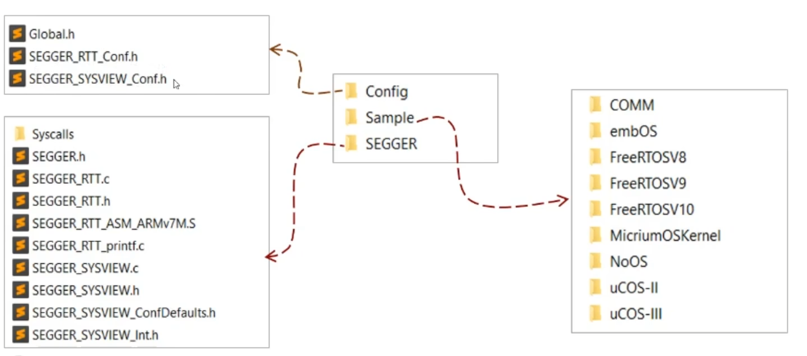

./Description/SYSVIEW_*.txt   SystemView API 描述文件。

./Sample/*.SVDat    : 参考案例

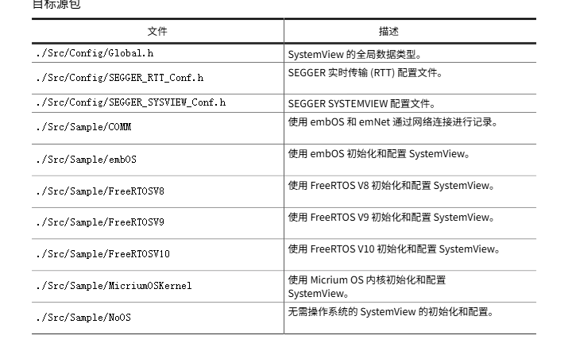

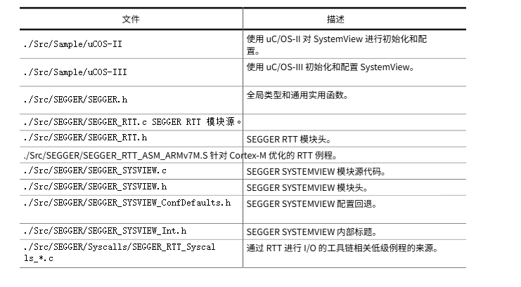

许可

SystemView 可在 SEGGER 友好许可证 (https://www.segger.com/license-sfl) 下免费用于非商业用途。其他用途则需获得商业用途许可证。

非商业许可证没有任何功能限制。SystemView 支持无限录制，并附带更强大的分析、搜索和筛选功能。

SystemView 的商业用途许可证包括单用户许可证、团体许可证或公司范围许可证。更多信息，请参阅 SEGGER 的商业用途许可证 (https://www.segger.com/license-cul)。

非商业许可证

SystemView 可以与非商业许可证一起使用，用于评估、教育和业余爱好者目的。

当您在非商业许可证下使用 SystemView 时，无需激活。启动 SystemView 应用程序时，会弹出一个窗口。点击“继续”以接受许可条款。


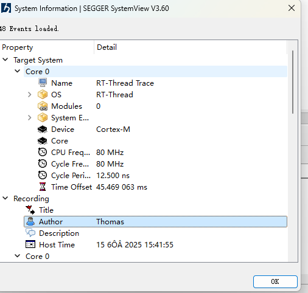


## 硬件链接

主要官方推荐是JLINK链接，当然你也可以通过UART或者TCP/IP来链接

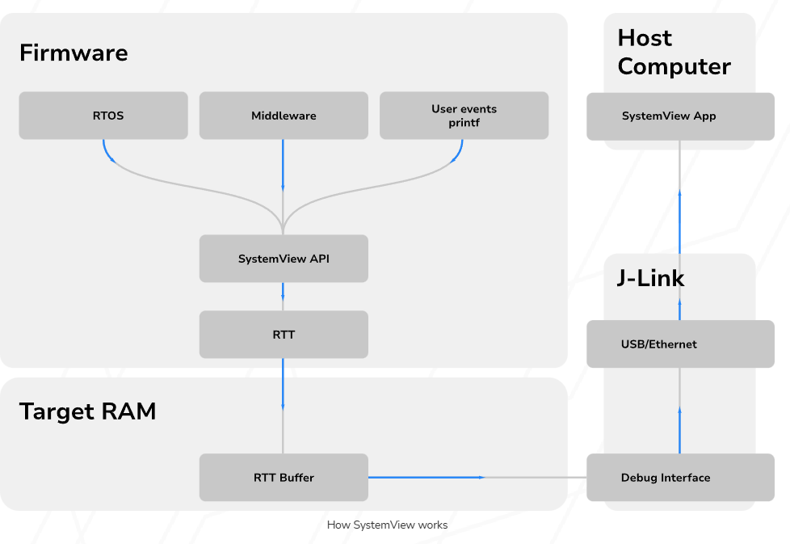

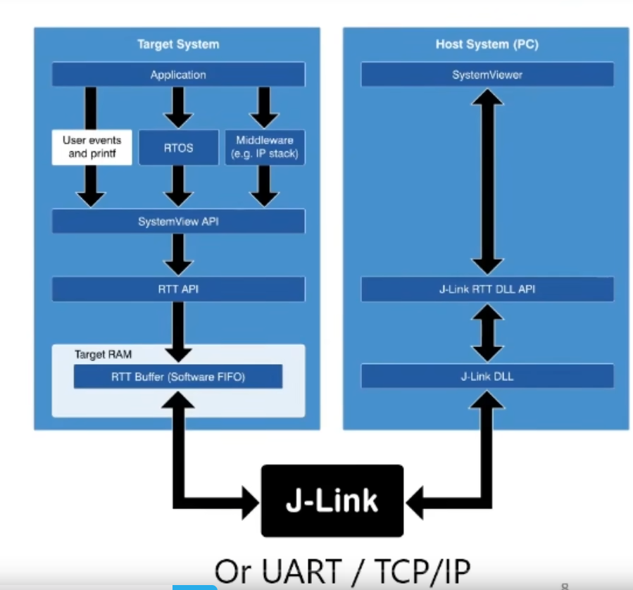

## SYSVIEW功能

SYSVIEW可以用来trace 线程的执行情况：

ID 的前32个ID ，由sysview来定义，每个事件都是固定的，后面的参数也是双方协商好的。

```
#define   SYSVIEW_EVTID_NOP                0  // Dummy packet.
#define   SYSVIEW_EVTID_OVERFLOW           1
#define   SYSVIEW_EVTID_ISR_ENTER          2
#define   SYSVIEW_EVTID_ISR_EXIT           3
#define   SYSVIEW_EVTID_TASK_START_EXEC    4
#define   SYSVIEW_EVTID_TASK_STOP_EXEC     5
#define   SYSVIEW_EVTID_TASK_START_READY   6
#define   SYSVIEW_EVTID_TASK_STOP_READY    7
#define   SYSVIEW_EVTID_TASK_CREATE        8
#define   SYSVIEW_EVTID_TASK_INFO          9
#define   SYSVIEW_EVTID_TRACE_START       10
#define   SYSVIEW_EVTID_TRACE_STOP        11
#define   SYSVIEW_EVTID_SYSTIME_CYCLES    12
#define   SYSVIEW_EVTID_SYSTIME_US        13
#define   SYSVIEW_EVTID_SYSDESC           14
#define   SYSVIEW_EVTID_MARK_START        15
#define   SYSVIEW_EVTID_MARK_STOP         16
#define   SYSVIEW_EVTID_IDLE              17
#define   SYSVIEW_EVTID_ISR_TO_SCHEDULER  18
#define   SYSVIEW_EVTID_TIMER_ENTER       19
#define   SYSVIEW_EVTID_TIMER_EXIT        20
#define   SYSVIEW_EVTID_STACK_INFO        21
#define   SYSVIEW_EVTID_MODULEDESC        22
#define   SYSVIEW_EVTID_DATA_SAMPLE       23
#define   SYSVIEW_EVTID_INIT              24
#define   SYSVIEW_EVTID_NAME_RESOURCE     25
#define   SYSVIEW_EVTID_PRINT_FORMATTED   26
#define   SYSVIEW_EVTID_NUMMODULES        27
#define   SYSVIEW_EVTID_END_CALL          28
#define   SYSVIEW_EVTID_TASK_TERMINATE    29

#define   SYSVIEW_EVTID_EX                31
```

对于SYSVIEW_EVTID_EX  31事件，还有拓展的子事件：

```
#define   SYSVIEW_EVTID_EX_MARK           0
#define   SYSVIEW_EVTID_EX_NAME_MARKER    1
#define   SYSVIEW_EVTID_EX_HEAP_DEFINE    2
#define   SYSVIEW_EVTID_EX_HEAP_ALLOC     3
#define   SYSVIEW_EVTID_EX_HEAP_ALLOC_EX  4
#define   SYSVIEW_EVTID_EX_HEAP_FREE      5
#define   SYSVIEW_EVTID_EX_REGISTER_DATA  6
```

后面再有事件，就是由一个description.txt的东西来定义了，和代码下面的内容相匹配，

```
#define RTT_TRACE_ID_OFFSET           (32u)

#define RTT_TRACE_ID_SEM_BASE         (40u)
#define RTT_TRACE_ID_SEM_TRYTAKE      ( 1u + RTT_TRACE_ID_SEM_BASE)
#define RTT_TRACE_ID_SEM_TAKEN        ( 2u + RTT_TRACE_ID_SEM_BASE)
#define RTT_TRACE_ID_SEM_RELEASE      ( 3u + RTT_TRACE_ID_SEM_BASE)

#define RTT_TRACE_ID_MUTEX_BASE       (50u)
#define RTT_TRACE_ID_MUTEX_TRYTAKE    ( 1u + RTT_TRACE_ID_MUTEX_BASE)
#define RTT_TRACE_ID_MUTEX_TAKEN      ( 2u + RTT_TRACE_ID_MUTEX_BASE)
#define RTT_TRACE_ID_MUTEX_RELEASE    ( 3u + RTT_TRACE_ID_MUTEX_BASE)

#define RTT_TRACE_ID_EVENT_BASE       (60u)
#define RTT_TRACE_ID_EVENT_TRYTAKE    ( 1u + RTT_TRACE_ID_EVENT_BASE)
#define RTT_TRACE_ID_EVENT_TAKEN      ( 2u + RTT_TRACE_ID_EVENT_BASE)
#define RTT_TRACE_ID_EVENT_RELEASE    ( 3u + RTT_TRACE_ID_EVENT_BASE)

#define RTT_TRACE_ID_MAILBOX_BASE     (70u)
#define RTT_TRACE_ID_MAILBOX_TRYTAKE  ( 1u + RTT_TRACE_ID_MAILBOX_BASE)
#define RTT_TRACE_ID_MAILBOX_TAKEN    ( 2u + RTT_TRACE_ID_MAILBOX_BASE)
#define RTT_TRACE_ID_MAILBOX_RELEASE  ( 3u + RTT_TRACE_ID_MAILBOX_BASE)

#define RTT_TRACE_ID_QUEUE_BASE       (80u)
#define RTT_TRACE_ID_QUEUE_TRYTAKE    ( 1u + RTT_TRACE_ID_QUEUE_BASE)
#define RTT_TRACE_ID_QUEUE_TAKEN      ( 2u + RTT_TRACE_ID_QUEUE_BASE)
#define RTT_TRACE_ID_QUEUE_RELEASE    ( 3u + RTT_TRACE_ID_QUEUE_BASE)
```

对应的description.txt中

```
41        sem_trytake               Try Take Sem=%s
42        sem_take                  Taken Sem=%s
43        sem_release               Release Sem=%s
44        OS_SetPriority            Task=%t Pri=%u
45        OS_WakeTask               Task=%t
46        OS_CreateTask             Task=%t Pri=%u Stack=%p Size=%u
47        OS_TerminateTask          Task=%t
48        OS_Suspend                Task=%t
49        OS_Resume                 Task=%t
50        OS_CreateTaskEx           Task=%t Pri=%u Stack=%p Size=%u Context=%p
51        mutex_trytake             Try Take Lock=%s
52        mutex_take                Taken Lock=%s
53        mutex_release             Release Lock=%s
54        OS_SignalEvent            Task=%t EventMask=%b
55        OS_ClearEvents            Task=%t                                     | Returns %b
61        event_tryrecv             Try Recv Event=%s Event=%p
62        event_recv                Recved Event=%s Event=%p
63        event_send                Send Event=%s Event=%p
64        OS_DeleteMB               MB=%p
65        OS_PutMail                MB=%p Mail=%p
66        OS_GetMail                MB=%p Dest=%p
67        OS_PutMailCond            MB=%p Mail=%p                               | Returns %u
68        OS_GetMailCond            MB=%p Dest=%p                               | Returns %u
70        OS_GetMailTimed           MB=%p Dest=%p Timeout=%u                    | Returns %u
71        mailbox_tryrecv           Try Recv Mail from Box=%s
72        mailbox_recv              Recved Mail from Box=%s
73        mailbox_send              Send Mail to Box=%s
74        OS_PutMailCond1           MB=%p Data=%u                               | Returns %u
75        OS_GetMailCond1           MB=%p Data=%p                               | Returns %u
78        OS_PutMailFront           MB=%p Mail=%p
79        OS_PutMailFront1          MB=%p Data=%u
80        OS_PutMailFrontCond       MB=%p Mail=%p                               | Returns %u
81        msgq_tryrecv              Try Recv Msg from Queue=%s
```

这些事件在触发的时候，调SYSVIEW的recored函数

```
SEGGER_SYSVIEW_RecordObject(RTT_TRACE_ID_SEM_TRYTAKE, object);
=>
void SEGGER_SYSVIEW_RecordObject(unsigned EventID, struct rt_object *object)
{
    U8  aPacket[SEGGER_SYSVIEW_INFO_SIZE + 4 * SEGGER_SYSVIEW_QUANTA_U32];
    U8 *pPayload;

    pPayload = SEGGER_SYSVIEW_PREPARE_PACKET(aPacket);                      // Prepare the packet for SystemView
    pPayload = SEGGER_SYSVIEW_EncodeString(pPayload, object->name, RT_NAME_MAX);    // Add object name

    if ((object->type & (~RT_Object_Class_Static)) == RT_Object_Class_Event)
        pPayload = SEGGER_SYSVIEW_EncodeU32(pPayload, ((rt_event_t)object)->set);

    SEGGER_SYSVIEW_SendPacket(&aPacket[0], pPayload, EventID);              // Send the packet
}
```

### 数据格式

在通信过程中数据是如何组包的呢？

先看UIN32_T如何整合的

如何整合UINT32的， 这里也用了相同的压缩办法，如果根据数据中是否大于0x7F的值，来整合。

```
#define ENCODE_U32(pDest, Value) {                                                  \
                                   U8* pSysviewPointer;                             \
                                   U32 SysViewData;                                 \
                                   pSysviewPointer = pDest;                         \
                                   SysViewData = (U32)Value;                        \
                                   while(SysViewData > 0x7F) {                      \
                                     *pSysviewPointer++ = (U8)(SysViewData | 0x80); \
                                     SysViewData >>= 7;                             \
                                   };                                               \
                                   *pSysviewPointer++ = (U8)SysViewData;            \
                                   pDest = pSysviewPointer;                         \
                                 };

```

比如数据是`1BB8`

转换成内存中的数据就是`B8` + `37`   (1BB8>>7)

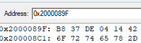

那上位机根据第一个字节第一个bit是否是1来判断后面有没有数据了


比如下面的事件,是进入TIMER定时器的时候的事件，ID为`SYSVIEW_EVTID_TIMER_ENTER`  值为`19` 十六进制是0x13

```
void SEGGER_SYSVIEW_RecordEnterTimer(U32 TimerId) {
  U8* pPayload;
  U8* pPayloadStart;
  RECORD_START(SEGGER_SYSVIEW_INFO_SIZE + SEGGER_SYSVIEW_QUANTA_U32);
  //
  pPayload = pPayloadStart;
  ENCODE_U32(pPayload, SHRINK_ID(TimerId));
  _SendPacket(pPayloadStart, pPayload, SYSVIEW_EVTID_TIMER_ENTER);
  RECORD_END();
}
```

从上面的代码看书，数据后面跟着一个32bit的数据，timerid， 这个数据压缩了一下

SHRINK_ID 是计算ID的偏移值

```
#define SHRINK_ID(Id)   ((Id) - _SYSVIEW_Globals.RAMBaseAddress)
```

_SYSVIEW_Globals 在函数`SEGGER_SYSVIEW_Init` 初始化的时候，会进行赋值

id一般传的是一个指针。

```
static void _cb_timer_enter(rt_timer_t t)
{
    SEGGER_SYSVIEW_RecordEnterTimer((rt_uint32_t)t);
}
```

现在数据是N个字节，在函数`_SendPacket` 中，会在后面再加N个字节的时间戳，时间戳记录的是delta的时间戳，所以需要系统提供一个tick  实现函数`SEGGER_SYSVIEW_GET_TIMESTAMP`

```
  TimeStamp  = SEGGER_SYSVIEW_GET_TIMESTAMP();
  Delta = TimeStamp - _SYSVIEW_Globals.LastTxTimeStamp;
  MAKE_DELTA_32BIT(Delta);
  ENCODE_U32(pEndPacket, Delta);
```

那现在放到`SEGGER_RTT` 里面就是9个字节了

同时注意，event 在组包的时候，根据第一个event_id的事件大小来判断

如果event事件小于24, 第一个字节是事件

```
  if (EventId < 24) {
    *--pStartPacket = (U8)EventId;
  } else {
```

如果大于24， 第二个字节加上后面数据payload的长度，

长度如果大于127， 则先放长度的高8个段，后面放长度的后面7个字段

```
    if (NumBytes > 127) {
      *--pStartPacket = (U8)(NumBytes >> 7);
      *--pStartPacket = (U8)(NumBytes | 0x80);
    } else {
      *--pStartPacket = (U8)NumBytes;
    }
```

eventid 也是同样的原理

```
    if (EventId < 127) {
      *--pStartPacket = (U8)EventId;
    } else {
      //
      // Backwards U32 encode EventId.
      //
      if (EventId < (1u << 14)) { // Encodes in 2 bytes
        *--pStartPacket = (U8)(EventId >>  7);
        *--pStartPacket = (U8)(EventId | 0x80);
      } else if (EventId < (1ul << 21)) {    // Encodes in 3 bytes
        *--pStartPacket = (U8)(EventId >> 14);
        *--pStartPacket = (U8)((EventId >>  7) | 0x80);
        *--pStartPacket = (U8)(EventId | 0x80);
      } else if (EventId < (1ul << 28)) {    // Encodes in 4 bytes
        *--pStartPacket = (U8)(EventId >> 21);
        *--pStartPacket = (U8)((EventId >> 14) | 0x80);
        *--pStartPacket = (U8)((EventId >>  7) | 0x80);
        *--pStartPacket = (U8)(EventId | 0x80);
      } else {                              // Encodes in 5 bytes
        *--pStartPacket = (U8)(EventId >> 28);
        *--pStartPacket = (U8)((EventId >> 21) | 0x80);
        *--pStartPacket = (U8)((EventId >> 14) | 0x80);
        *--pStartPacket = (U8)((EventId >>  7) | 0x80);
        *--pStartPacket = (U8)(EventId | 0x80);
      }
    }
```

先放长度，根据后面的自己的最高bit位是否是1来判断数据是否结束，如果是1，则未结束，直到找到后面数据第一个bit不为1的数据，说明前面结束了。

最后通过接口SEGGER_RTT_WriteSkipNoLock 写到ringbuffer中，

```
  Status = SEGGER_RTT_WriteSkipNoLock(CHANNEL_ID_UP, pStartPacket, (unsigned int)(pEndPacket - pStartPacket));
```


所以对于时间戳`0x60D`  事件0x13, timer_id=1BB8的数据格式如下，占5个字节：

```
0x13 0xB8 0x37 0x8d 0x0c
```

0x60D | 0x80 = 0x8d

0x60d>>7 = 0x0c

所以第一个字节是事件

第二个字节会根据事件来判断

所以sysview根据第一个字节的第一个bit来判断后面有没有数据，如果bit8为1代表后面还有数据， bit8为0代表当前单元没有数据了

对于长度NumBytes，对于eventid大于24的时候，有长度,有长度会放长度

第一个字段是eventId，第二个字段是num，根据第8bit来判断。后面也是


参考的数据格式如下：

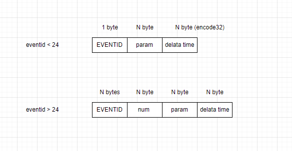


N byte代表可能是uint32或者string，encode 32是

这种编码方式叫做：**变长字节编码（Variable-length Quantity, VLQ）**

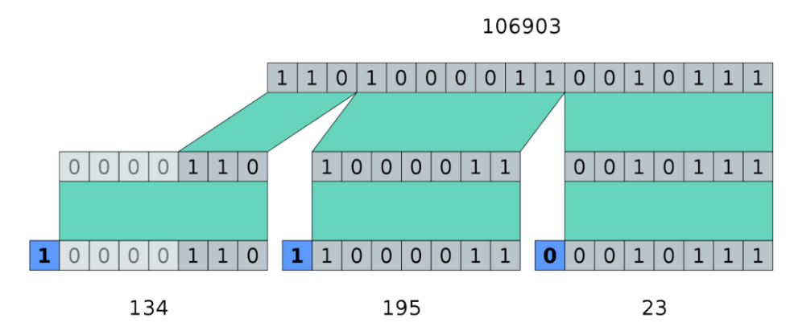

### 这种编码方式常见的名称

1. **Varint**（变长整数编码）：Google Protocol Buffers等使用的主流方式。
2. **VLQ**（Variable-length quantity）：MIDI、ASN.1中常见。
3. **LEB128**（Little Endian Base 128）：DWARF调试信息、WebAssembly等场合。


https://protobuf.dev/programming-guides/encoding/#varints

https://en.wikipedia.org/wiki/Variable-length_quantity

https://en.wikipedia.org/wiki/LEB128


## SYSVIEW 使用

数据跟踪，

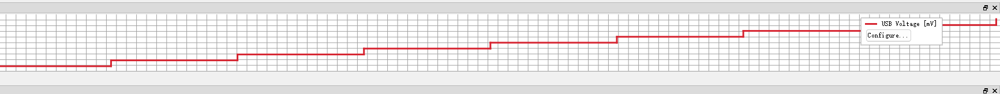


```
SEGGER_SYSVIEW_DATA_REGISTER VoltagePlot;
VoltagePlot.ID = 0;
VoltagePlot.sName = "USB Voltage";
VoltagePlot.DataType = SEGGER_SYSVIEW_TYPE_U32;
VoltagePlot.Offset = 0;
VoltagePlot.RangeMin = 0;
VoltagePlot.RangeMax = 0;
VoltagePlot.ScalingFactor = 1;
VoltagePlot.sUnit = "mV";
SEGGER_SYSVIEW_RegisterData(&VoltagePlot);

U32 _VUsb;
SEGGER_SYSVIEW_DATA_SAMPLE PlotVoltage;
PlotVoltage.Id            = 0;
PlotVoltage.pValue.pU32   = &_VUsb;
_VUsb++;
SEGGER_SYSVIEW_SampleData(&PlotVoltage);
```

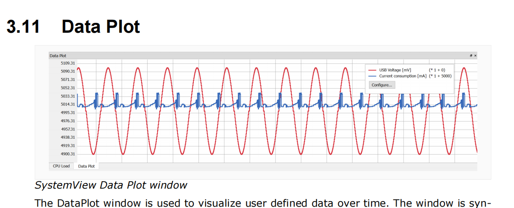

这个实时跟踪数据，比较方便。

其他的

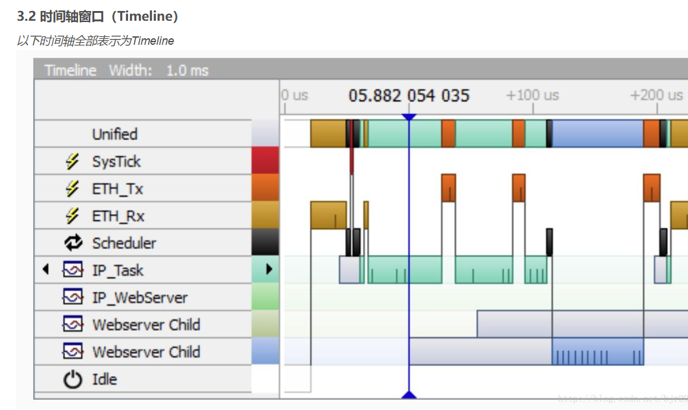

SystemView Timeline

Timeline窗口在一个界面中集中了所有系统信息。它在系统时间线上显示了系统活动(任务、中断、调度器、定时器和空闲)。它显示在被监视的应用程序中使用的所有上下文项，且每行显示一个上下文项。

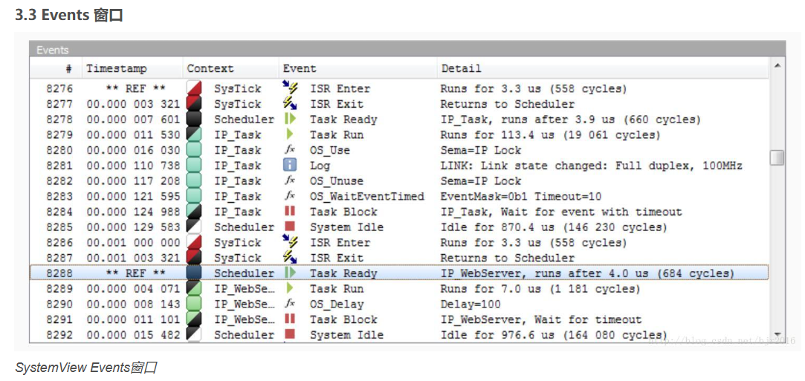

Events窗口显示系统发送的所有事件，并显示它们的信息。每个事件都有以下几项：

在目标时间或记录时间内的时间戳，可以用微秒或纳秒分辨率显示
创建Events的上下文，即运行的任务。
Event描述，和事件类型一起显示，(IRS进入和退出，任务活动，API调用)。
Event细节描述事件的参数，即API调用参数。
在列表中定位事件的ID。

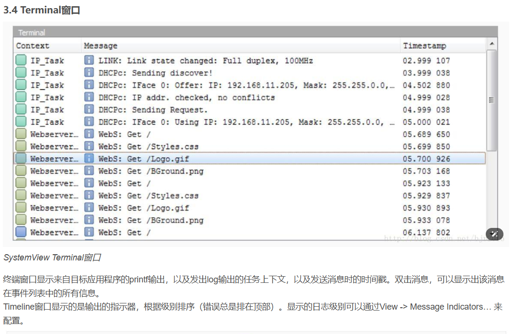

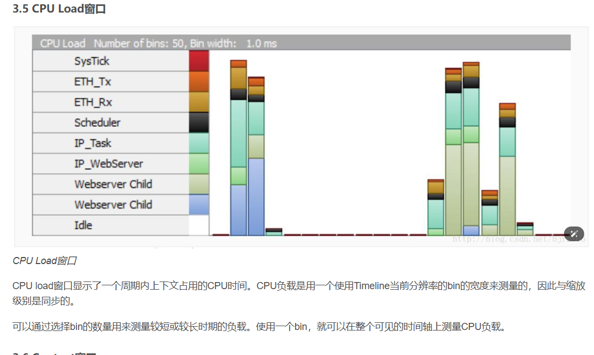

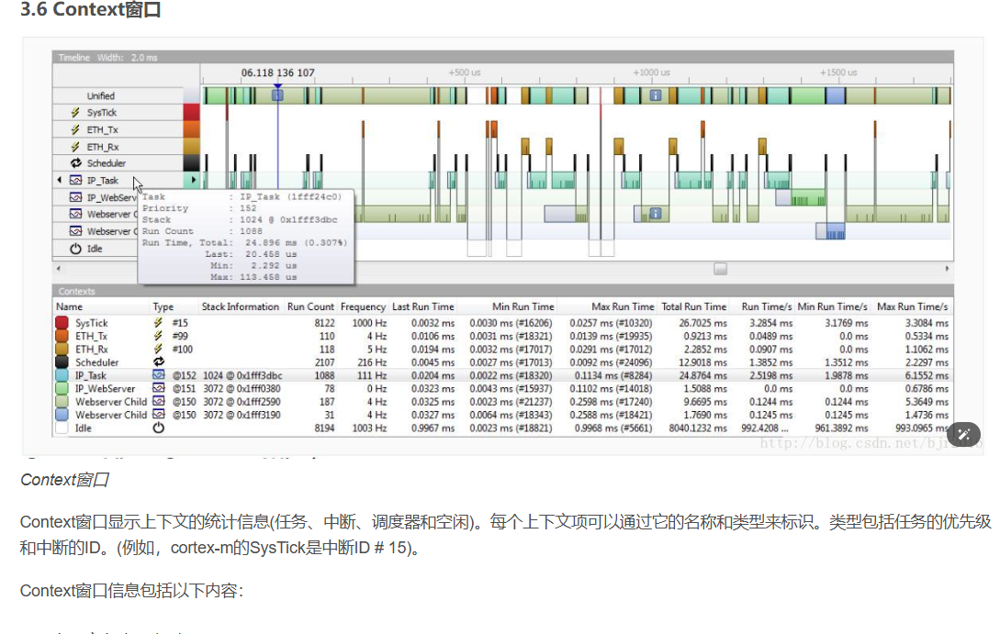

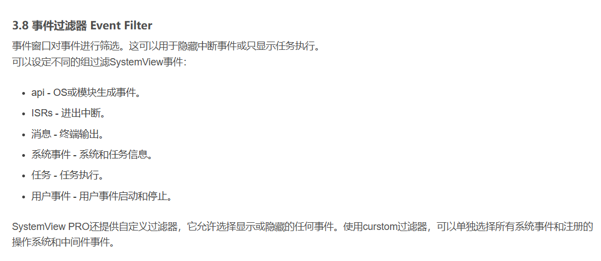

参考链接

https://www.bilibili.com/video/BV1Pc411H71C/?spm_id_from=333.337.search-card.all.click&vd_source=207af3635dd52709beac139d1cf4a3f5
https://www.bilibili.com/video/BV1XM4y1G76d/?spm_id_from=333.337.search-card.all.click&vd_source=207af3635dd52709beac139d1cf4a3f5
https://www.cnblogs.com/suozhang/p/10039457.html
https://blog.csdn.net/qq_36973838/article/details/131662409
https://blog.csdn.net/bjr2016/article/details/78495508
https://blog.csdn.net/bjr2016/article/details/78474154
https://blog.csdn.net/bjr2016/article/details/78562414
https://blog.csdn.net/bjr2016/article/details/78562320
https://blog.csdn.net/a1058191679/article/details/127315783
https://blog.csdn.net/lzs940320/article/details/105789810

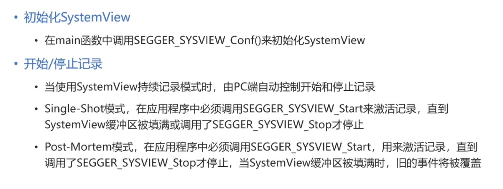

## description

为了使 SystemView 能够正确解码 API 调用，需要在 SystemView 的 /description/ 目录中有一个描述文件。该文件的名称必须是 SYSVIEW_ .txt 其中是系统描述中发送的名称

格式

```
<EventID> <FunctionName> <ParameterDescription> | <ReturnValueDescription>
```

EventID是记录 API 函数的 Id，取值范围为 32~511。

FunctionName是 API 函数的名称，显示在 SystemView 的 Event 列中。不能包含空格。

ParameterDescription 是 API 函数记录的参数描述字符串。

ReturnValueDescription 是返回值的描述字符串，可以使用 SystemView 记录。ReturnValueDescription 是可选的。

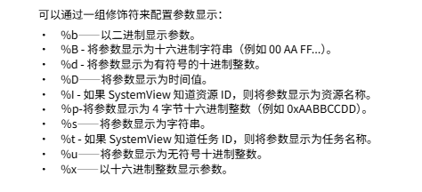

例子

```
35 OS_CheckTimer pGlobal=%p
42 OS_Delay Delay=%u
43 OS_DelayUntil Time=%u
44 OS_setPriority Task=%t Pri=%u
45 OS_WakeTask Task=%t
46 OS_CreateTask Task=%t Pri=%u Stack=%p Size=%u
```

同时也可以定义一些名称对应的数字比如

```
#
# Types for parameter formatters
#
NamedType OSErr 0=OS_ERR_NONE
NamedType OSErr 10000=OS_ERR_A 10001=OS_ERR_ACCEPT_ISR
NamedType OSErr 12000=OS_ERR_C 12001=OS_ERR_CREATE_ISR
NamedType OSErr 13000=OS_ERR_D 13001=OS_ERR_DEL_ISR
NamedType OSFlag 0=FLAG_NONE 1=FLAG_READ 2=FLAG_WRITE 3=FLAG_READ_WRITE
#
# API Functions
#
34 OSFunc Param=%OSFlag | Returns %OSErr
```

OSFlag 对应的值0,1,2,3 就是上面的NameType

#### 任务状态描述


```
# Task States
#
TaskState 0xFF 0=Ready, 1=Delayed or Timeout, 2=Pending, 3=Pending with Timeout,
4=Suspended, 5=Suspended with Timeout, 6=Suspended and Pending, 7=Suspended and
Pending with Timeout, 255=Deleted
```

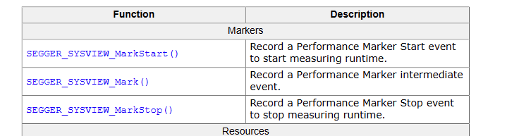


systemview 消耗状态

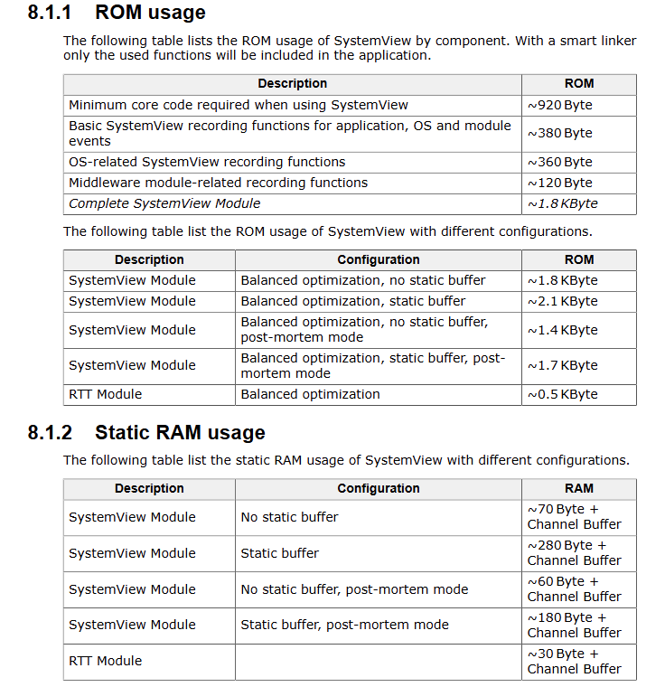

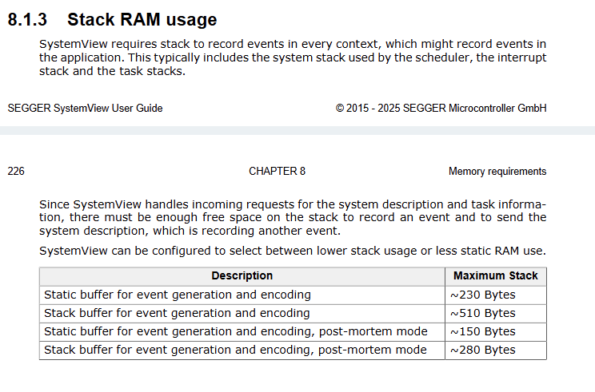

## API简介


|                               |      |      |
| ----------------------------- | ---- | ---- |
| SEGGER_SYSVIEW_Init           |      |      |
| SEGGER_SYSVIEW_SetRAMBase     |      |      |
| SEGGER_SYSVIEW_Start          |      |      |
| SEGGER_SYSVIEW_Stop           |      |      |
| SEGGER_SYSVIEW_GetSysDesc     |      |      |
| SEGGER_SYSVIEW_SendTaskList   |      |      |
| SEGGER_SYSVIEW_SendTaskInfo   |      |      |
| SEGGER_SYSVIEW_SendSysDesc    |      |      |
| SEGGER_SYSVIEW_IsStarted      |      |      |
| SEGGER_SYSVIEW_GetChannelID   |      |      |
| SEGGER_SYSVIEW_SampleData     |      |      |
|                               |      |      |
| SEGGER_SYSVIEW_RecordVoid     |      |      |
| SEGGER_SYSVIEW_RecordU32      |      |      |
| SEGGER_SYSVIEW_RecordU32x2    |      |      |
| SEGGER_SYSVIEW_RecordU32x10   |      |      |
| SEGGER_SYSVIEW_RecordString   |      |      |
| SEGGER_SYSVIEW_RecordSystime  |      |      |
| SEGGER_SYSVIEW_RecordEnterISR |      |      |
| SEGGER_SYSVIEW_RecordExitISR  |      |      |


|                                 |      |      |
| ------------------------------- | ---- | ---- |
| SEGGER_SYSVIEW_OnIdle           |      |      |
| SEGGER_SYSVIEW_OnTaskCreate     |      |      |
| SEGGER_SYSVIEW_OnTaskTerminate  |      |      |
| SEGGER_SYSVIEW_OnTaskStartExec  |      |      |
| SEGGER_SYSVIEW_OnTaskStopExec   |      |      |
| SEGGER_SYSVIEW_OnTaskStartReady |      |      |
| SEGGER_SYSVIEW_OnTaskStopReady  |      |      |
| SEGGER_SYSVIEW_MarkStart        |      |      |
| SEGGER_SYSVIEW_MarkStop         |      |      |
| SEGGER_SYSVIEW_Mark             |      |      |
| SEGGER_SYSVIEW_NameMarker       |      |      |
| SEGGER_SYSVIEW_HeapDefine       |      |      |
| SEGGER_SYSVIEW_HeapAlloc        |      |      |
| SEGGER_SYSVIEW_HeapAllocEx      |      |      |
| SEGGER_SYSVIEW_HeapFree         |      |      |
| SEGGER_SYSVIEW_NameResource     |      |      |
| SEGGER_SYSVIEW_RegisterData     |      |      |
| SEGGER_SYSVIEW_SendPacket       |      |      |
|                                 |      |      |


|                                        |      |      |
| -------------------------------------- | ---- | ---- |
| SEGGER_SYSVIEW_EncodeU32               |      |      |
| SEGGER_SYSVIEW_EncodeData              |      |      |
| SEGGER_SYSVIEW_EncodeString            |      |      |
| SEGGER_SYSVIEW_EncodeId                |      |      |
| SEGGER_SYSVIEW_ShrinkId                |      |      |
|                                        |      |      |
| SEGGER_SYSVIEW_RegisterModule          |      |      |
| SEGGER_SYSVIEW_RecordModuleDescription |      |      |
| SEGGER_SYSVIEW_SendModule              |      |      |
| SEGGER_SYSVIEW_SendModuleDescription   |      |      |
| SEGGER_SYSVIEW_SendNumModules          |      |      |
|                                        |      |      |
| SEGGER_SYSVIEW_PrintfHostEx            |      |      |
| SEGGER_SYSVIEW_VPrintfHostEx           |      |      |
| SEGGER_SYSVIEW_PrintfTargetEx          |      |      |
| SEGGER_SYSVIEW_VPrintfTargetEx         |      |      |
| SEGGER_SYSVIEW_PrintfHost              |      |      |
|                                        |      |      |
| SEGGER_SYSVIEW_Print                   |      |      |
| SEGGER_SYSVIEW_Warn                    |      |      |
| SEGGER_SYSVIEW_Error                   |      |      |


SEGGER_SYSVIEW_EnableEvents

SEGGER_SYSVIEW_DisableEvents

SEGGER_SYSVIEW_Conf

SEGGER_SYSVIEW_X_GetTimestamp

SEGGER_SYSVIEW_X_GetInterruptId

SEGGER_SYSVIEW_X_OnEventRecorded