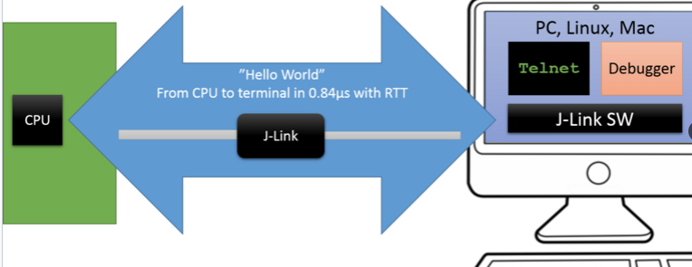
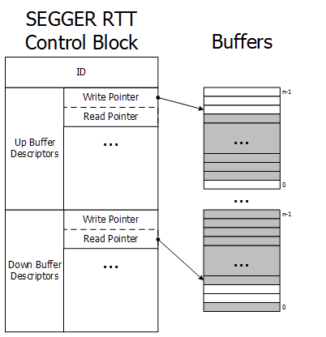
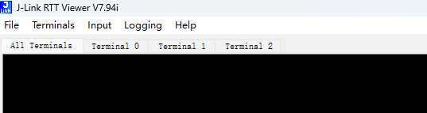
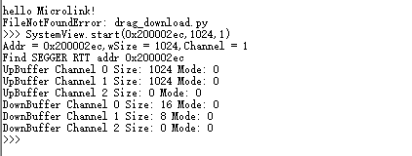

# SEGGER_RTT 功能简介

## SEGGER_RTT功能简介

本文主要讲`segger_rtt` 的主要功能，

`segger_rtt` 的源码`C:\Program Files\SEGGER\JLink_V818\Samples\RTT`

一般你装了jlink之后，就有了

### 包含文件

  * `RTT/`
    * `SEGGER_RTT.c`               - 主要模块.
    * `SEGGER_RTT.h`               - 主要头文件.
    * `SEGGER_RTT_ASM_ARMv7M.S`    - 对于 ARMv7M processors的优化.，用汇编实现 写函数`SEGGER_RTT_WriteSkipNoLock`
    * `SEGGER_RTT_Printf.c`        - 简单的printf实现，基于 RTT的.
  * `Syscalls/`
    * `SEGGER_RTT_Syscalls_*.c`    -对于 `printf()` 不同的toolchain的实现，比如puts等.
  * `Config/`
    * `SEGGER_RTT_Conf.h`          - RTT 配置文件.
  * `Examples/`                               - 例子
    * `Main_RTT_InputEchoApp.c`    -在 Channel 0 打印数据。 演示输入一个字节，输出一个字节。
    * `Main_RTT_MenuApp.c`         - 演示RTT双向功能的示例应用程序. 这个主要演示输入输出
    * `Main_RTT_PrintfTest.c`      - 示例应用程序测试RTT的简单打印实现. 演示printf功能
    * `Main_RTT_SpeedTestApp.c`    - 测量RTT性能的示例应用程序。(需要embos)

### SEGGER_RTT 

内容

https://kb.segger.com/RTT




SEGGER 的实时传输（RTT）是一种嵌入式应用中交互式用户输入/输出的技术。它结合了 SWO 和半主机模式的优点，并具有非常高的性能。使用 RTT，可以在不影响目标实时行为的情况下，以非常高的速度从目标微控制器输出信息并发送输入到应用程序。

RTT 支持双向的多个通道，从主机到目标，再到目标，可以用于不同的目的，并为用户提供最大的自由度。

默认实现使用每个方向一个通道，这些通道用于可打印的终端输入和输出。通过 J-Link RTT 观察器，这些通道可以用于多个“虚拟”终端，允许将输出打印到多个窗口（例如，一个用于标准输出，一个用于错误输出，一个用于调试输出）而只需要一个目标缓冲区。此外，还可以使用一个从目标到主机的通道来发送性能分析或事件跟踪数据（例如，用于 SEGGER SystemView）。



上行和下行缓冲区可以单独处理（参见 RTT 通道）。

- 每个通道可以配置为阻塞或非阻塞（参见缓冲区配置）：

  - 阻塞：防止数据丢失，但可能会暂停应用程序。

  - 非阻塞：多余的信息将被丢弃，使应用程序能够在没有调试器连接的情况下实时运行。

阻塞和非阻塞就是在中间加了一个互斥锁，锁定CPU的使用权。

```
unsigned SEGGER_RTT_Write(unsigned BufferIndex, const void* pBuffer, unsigned NumBytes) {
  unsigned Status;

  INIT();
  SEGGER_RTT_LOCK();
  Status = SEGGER_RTT_WriteNoLock(BufferIndex, pBuffer, NumBytes);  // Call the non-locking write function
  SEGGER_RTT_UNLOCK();
  return Status;
}
```

SEGGER_RTT_WriteNoLock： 非阻塞，不是很安全，会有可能数据会乱，如果中断中打断了，并且发数据了，这个时候数据就乱了。

### SEGGER buffer

缓冲描述符提供了每个通道的环形缓冲区信息，J-Link 使用这些信息从目标读取信息或将信息写入目标。可以有任意数量的上行（目标 -> 主机）/ 下行（主机 -> 目标）缓冲描述符，直到达到允许的最大通道数。

对于up缓冲区

- write只由目标写入，比如MCU或者被记录的log。
- read只由上位机，比如jlink，host主机等。

下行数据down 类似

- 写由jlink，host写入
- 读由MCU读

这确保不会发生竞争条件。当读指针和写指针指向同一个元素时，缓冲区为空。

环形缓冲区也位于 RAM 中，但不属于 RTT CB。缓冲区大小可以为每个通道和每个方向单独配置。上图中缓冲区的灰色区域表示包含有效数据的区域。

SEGGER RTT 不需要任何额外的引脚或硬件，即使通过标准调试端口连接了 J-Link 至目标。它不需要对目标或调试环境进行任何配置，甚至可以在目标以不同速度运行时使用。

RTT 可以在运行中的调试会话中并行使用，而不会干扰调试，甚至完全不使用 IDE 或调试器也可以使用。

RTT 实现代码使用约 500 字节的 ROM 和 24 字节的 ID + 每个通道 24 字节的控制块在 RAM 中。每个通道需要一些内存用于缓冲区。推荐的大小是上行通道 1 kByte，下行通道 16 到 32 字节，具体取决于输入/输出的负载。

通常下行不需要太多字节，上行需要1k数据，比较合理。

### 自动检测控制块

RTT 允许 J-Link 在给定的 RAM 范围内自动检测控制块（CB）。默认情况下使用自动检测，但用户也可以提供特定的控制块地址或特定的 RAM 范围来搜索 CB。当 RTT 在主机计算机上激活时，无论是通过应用程序如 J-Link RTT Viewer 直接使用 RTT，还是通过 Telnet 连接到使用 J-Link 的应用程序（如调试器），J-Link 都会自动通过向量表中指定的地址、目标的 RAM 区域（由 J-Link 软件指定的自动检测）和/或用户指定的地址来搜索 SEGGER RTT 控制块。通常检测魔术字"SEGGER"

默认情况下，自动检测用于定位 RTT 控制块（CB）。这意味着 J-Link 会首先尝试在向量表的偏移 0x20 处定位控制块的地址。需要将地址加上 0x2 来标记为有效的 RTT 控制块地址。参见示例向量表以获得帮助。如果找不到该地址，J-Link 将搜索指定目标已知的 J-Link 软件中的 RAM。

对于大多数 MCU 来说，当选择自动检测时，并非所有 RAM 区域都会被搜索。这是因为存在多种原因：

搜索区域在 RAM 中越大，定位控制块（在 RAM 超过 30MB 的目标上）所需的时间就越长

并非所有 RAM 区域在所有时间都可用，这取决于目标的状态，而在不活跃状态下访问它们可能会导致未定义行为或 HardFault

RAM 可能是可配置的

RAM 在某些 MCU 状态下可能是不可访问的（例如，TrustZone 安全/非安全区域）

RAM 可能未默认启用，也可能被用户禁用。

仅在非 Cortex-M 目标中，RAM 可能无法通过选定的 MEM-AP 访问。

虽然在大多数情况下，RTT 控制块位置的自动检测可以正常工作，但始终可以手动指定 RTT 控制块的确切位置，或者指定 J-Link 搜索控制块的具体地址范围。

这可以通过多种方式实现。例如：

使用 J-Link 命令字符串，例如在 J-Link 脚本文件中：

通过所使用的工具（如果支持的话），例如 J-Link RTT 观察器的配置对话框

通过 J-Link TELNET 通道


## 通道

通道中有几个概念：

- Blocking： 当缓冲区满时，应用程序会等待直到所有内存都被写入，从而导致应用程序处于阻塞状态，但可以防止数据丢失。
- Non-blocking, skip: 如果上行缓冲区没有足够的空间来容纳所有传入数据，**所有数据将被丢弃。**
- Non-blocking, trim : 如果上缓冲区没有足够的空间来容纳所有传入数据，**将填充可用空间的传入数据**，并丢弃其余数据。
- BLOCK-IF-FIFO-FULL:  一直等到有空间写入，否则阻塞


## 背景访问


## 实现

SEGGER RTT 实现代码使用 ANSI C 编写，并可以通过简单地添加可用源代码将其集成到任何嵌入式应用中。

RTT 可通过一个简单易用的 API 来使用。甚至可以覆盖标准的 `printf()` 函数以与 RTT 兼容。使用 RTT 可将输出时间降至最小，并允许在应用程序执行关键实时任务时将调试信息打印到主机计算机上。

SEGGER RTT 实现可以在编译时通过预处理器定义进行完全配置。可以设置通道的数量以及默认通道的大小。可以通过定义 `Lock()` 和 `Unlock()` 函数使读写操作成为任务安全的操作。

github代码： https://github.com/SEGGERMicro/RTT


RTT 实现期望控制块位于以下两种状态之一的 RAM 位置：

0 初始化状态，当 RTT 尚未设置时。这是大多数用户的默认情况。

已设置的控制块状态。这允许在多应用设置（如引导加载程序 + 主应用）中共享控制块。

在其他情况下，必须先调用 SEGGER_RTT_Init()，然后再调用任何其他 RTT 函数！


| API functions  API 函数                                      | 说明                                           |
| ------------------------------------------------------------ | ---------------------------------------------- |
| SEGGER_RTT_ConfigDownBuffer(Index, sName, pBuffer,BufferSize, Flags) | 配置下行缓冲区                                 |
| SEGGER_RTT_ConfigUpBuffer(Index, sName, pBuffer,BufferSize, Flags) | 配置上行缓冲区                                 |
| SEGGER_RTT_GetKey(void)                                      | 从index 0中down读取值                          |
| SEGGER_RTT_HasKey(void)                                      | index 0 中down有值，1有值，0 没值              |
| SEGGER_RTT_HasData(void)                                     | index 0 中down有多少值                         |
| SEGGER_RTT_Init(void)                                        | 初始化 index0                                  |
| SEGGER_RTT_printf(Index, const char * sFormat, ...)          | printf打印                                     |
| SEGGER_RTT_Read(index,buffer,len)                            | 对特定的index 读数据                           |
| SEGGER_RTT_SetTerminal(unsigned char TerminalId)             | 这个会设置某个termial为1，这里还是操作的index0 |
| SEGGER_RTT_TerminalOut(TerminalId, char *s)                  | 这个往terminal中写数据，实际上操作还是index0   |
| SEGGER_RTT_WaitKey(void)                                     | 这个会一直等待index 0的有数据进来，死等        |
| SEGGER_RTT_Write(BufferIndex， buffer，len)                  | 往index 中写数据                               |
| SEGGER_RTT_WriteString(bufferindex, char *s)                 | 往某个index中写字符串                          |
| SEGGER_RTT_GetAvailWriteSpace(bufferindex)                   | 获取index的空闲buffer,还可以往里面写多少数据   |
| SEGGER_RTT_GetBytesInBuffer(bufferindex)                     | 获取index中的数据，已经有多少数据了            |


SEGGER_RTT_SetTerminal

这个实际上在buffer中填了两个字节作为terminal的标识， 0xff，terminal_id

```
_WriteBlocking(pRing, (const char*)ac, 2u);
```

即数据的头部为0xff和terminal_id

terminal，比如有些数据我们想单独看，在rtt view可以单独显示



## 配置

| Define / Routine                  | Meaning                                             |
| --------------------------------- | --------------------------------------------------- |
| `SEGGER_RTT_MAX_NUM_DOWN_BUFFERS` | 默认值2， 设置3 ，最大下行通道数， 0:RTT, 1:SYSVIEW |
| `SEGGER_RTT_MAX_NUM_UP_BUFFERS`   | 默认值2， 设置3，最大上行通道数， 0:RTT, 1:SYSVIEW  |
| `BUFFER_SIZE_DOWN`                | channel 0 默认大小，16byte， 接收最大一次16byte     |
| `BUFFER_SIZE_UP`                  | channel 0 默认大小，1024byte，发送最大一次1024字节  |
| `SEGGER_RTT_PRINT_BUFFER_SIZE`    | printf的最大字节，默认值64，                        |
| `SEGGER_RTT_LOCK()`               | 加锁                                                |
| `SEGGER_RTT_UNLOCK()`             | 解锁                                                |
| `SEGGER_RTT_SECTION`              |                                                     |
| `SEGGER_RTT_BUFFER_SECTION`       | 这个是需要把buffer定义在哪个段里面的宏              |
| `SEGGER_RTT_PUT_SECTION`          | 通过这个宏把buffer定义到某个段里面`__attribute__`   |


SEGGER_RTT_MEMCPY_USE_BYTELOOP： 是否一个字节一个字节拷贝，还是用memcpy


SEGGER_RTT_MAX_INTERRUPT_PRIORITY： 锁中的中断优先级的屏蔽等级primask 相关的配置

```
    #define SEGGER_RTT_LOCK()   {                                                                   \
                                  unsigned int _SEGGER_RTT__LockState;                                           \
                                  _SEGGER_RTT__LockState = _set_interrupt_priority(SEGGER_RTT_MAX_INTERRUPT_PRIORITY);

    #define SEGGER_RTT_UNLOCK()   _set_interrupt_priority(_SEGGER_RTT__LockState);                               \
```

## SEGGER_RTT 用到的lib函数

strlen: stringprintf需要，

strcpy: string 需要

MEMCPY: 拷贝数据的时候需要

```
#ifndef   MIN
  #define MIN(a, b)                                       (((a) < (b)) ? (a) : (b))
#endif

#ifndef   MAX
  #define MAX(a, b)                                       (((a) > (b)) ? (a) : (b))
#endif
```

SEGGER_RTT_BUFFER_ALIGN: 对齐

SEGGER_RTT_CPU_CACHE_LINE_SIZE: 缓存

### SEGGER 进程控制块


```
typedef struct {
  char                    acID[16];                                 // Initialized to "SEGGER RTT"
  int                     MaxNumUpBuffers;                          // Initialized to SEGGER_RTT_MAX_NUM_UP_BUFFERS (type. 2)
  int                     MaxNumDownBuffers;                        // Initialized to SEGGER_RTT_MAX_NUM_DOWN_BUFFERS (type. 2)
  SEGGER_RTT_BUFFER_UP    aUp[SEGGER_RTT_MAX_NUM_UP_BUFFERS];       // Up buffers, transferring information up from target via debug probe to host
  SEGGER_RTT_BUFFER_DOWN  aDown[SEGGER_RTT_MAX_NUM_DOWN_BUFFERS];   // Down buffers, transferring information down from host via debug probe to target
#if SEGGER_RTT__CB_PADDING
  unsigned char           aDummy[SEGGER_RTT__CB_PADDING];
#endif
} SEGGER_RTT_CB;

```


```
typedef struct {
  const     char*    sName;         // Optional name. Standard names so far are: "Terminal", "SysView", "J-Scope_t4i4"
            char*    pBuffer;       // Pointer to start of buffer
            unsigned SizeOfBuffer;  // Buffer size in bytes. Note that one byte is lost, as this implementation does not fill up the buffer in order to avoid the problem of being unable to distinguish between full and empty.
            unsigned WrOff;         // Position of next item to be written by either target.
  volatile  unsigned RdOff;         // Position of next item to be read by host. Must be volatile since it may be modified by host.
            unsigned Flags;         // Contains configuration flags
} SEGGER_RTT_BUFFER_UP;

typedef struct {
  const     char*    sName;         // Optional name. Standard names so far are: "Terminal", "SysView", "J-Scope_t4i4"
            char*    pBuffer;       // Pointer to start of buffer
            unsigned SizeOfBuffer;  // Buffer size in bytes. Note that one byte is lost, as this implementation does not fill up the buffer in order to avoid the problem of being unable to distinguish between full and empty.
  volatile  unsigned WrOff;         // Position of next item to be written by host. Must be volatile since it may be modified by host.
            unsigned RdOff;         // Position of next item to be read by target (down-buffer).
            unsigned Flags;         // Contains configuration flags
} SEGGER_RTT_BUFFER_DOWN;
```

Standard names so far are: "Terminal", "SysView", "J-Scope_t4i4"


acID 值是："SEGGER RTT"

用于JLINK来查找CB的头部的。

SEGGER_RTT_BUFFER_UP 这个只是定义了指针，




其他的定义了一些TRACE ID的

```
#define RTT_TRACE_ID_OFFSET           (32u)

#define RTT_TRACE_ID_SEM_BASE         (40u)
#define RTT_TRACE_ID_SEM_TRYTAKE      ( 1u + RTT_TRACE_ID_SEM_BASE)
#define RTT_TRACE_ID_SEM_TAKEN        ( 2u + RTT_TRACE_ID_SEM_BASE)
#define RTT_TRACE_ID_SEM_RELEASE      ( 3u + RTT_TRACE_ID_SEM_BASE)

#define RTT_TRACE_ID_MUTEX_BASE       (50u)
#define RTT_TRACE_ID_MUTEX_TRYTAKE    ( 1u + RTT_TRACE_ID_MUTEX_BASE)
#define RTT_TRACE_ID_MUTEX_TAKEN      ( 2u + RTT_TRACE_ID_MUTEX_BASE)
#define RTT_TRACE_ID_MUTEX_RELEASE    ( 3u + RTT_TRACE_ID_MUTEX_BASE)

#define RTT_TRACE_ID_EVENT_BASE       (60u)
#define RTT_TRACE_ID_EVENT_TRYTAKE    ( 1u + RTT_TRACE_ID_EVENT_BASE)
#define RTT_TRACE_ID_EVENT_TAKEN      ( 2u + RTT_TRACE_ID_EVENT_BASE)
#define RTT_TRACE_ID_EVENT_RELEASE    ( 3u + RTT_TRACE_ID_EVENT_BASE)

#define RTT_TRACE_ID_MAILBOX_BASE     (70u)
#define RTT_TRACE_ID_MAILBOX_TRYTAKE  ( 1u + RTT_TRACE_ID_MAILBOX_BASE)
#define RTT_TRACE_ID_MAILBOX_TAKEN    ( 2u + RTT_TRACE_ID_MAILBOX_BASE)
#define RTT_TRACE_ID_MAILBOX_RELEASE  ( 3u + RTT_TRACE_ID_MAILBOX_BASE)

#define RTT_TRACE_ID_QUEUE_BASE       (80u)
#define RTT_TRACE_ID_QUEUE_TRYTAKE    ( 1u + RTT_TRACE_ID_QUEUE_BASE)
#define RTT_TRACE_ID_QUEUE_TAKEN      ( 2u + RTT_TRACE_ID_QUEUE_BASE)
#define RTT_TRACE_ID_QUEUE_RELEASE    ( 3u + RTT_TRACE_ID_QUEUE_BASE)

```

